

<picture>
<source media="(prefers-color-scheme: dark)" srcset="assets/hero-dark.svg">
</picture>

I research AI and LLMs, and build all kinds of things along the way.

<code>kosen26s</code> · National Institute of Technology, Akashi College

 
<picture>
<source media="(prefers-color-scheme: dark)" srcset="assets/type/selected-work-dark.svg">
</picture>

<a href="https://github.com/TKY-27/MacEase">
<picture>
<source media="(prefers-color-scheme: dark)" srcset="assets/type/macease-dark.svg">

</picture>
</a>
 
Convert, compress, and edit files straight from Finder's right-click menu. 
With yt-dlp and other handy tools built in, it aims to let you finish almost everything without leaving Finder. 
Swift · <a href="https://github.com/TKY-27/MacEase">Repository</a> · <a href="https://macease-site.pages.dev/">Website</a>

<a href="https://github.com/TKY-27/OpenShogiAI">
<picture>
<source media="(prefers-color-scheme: dark)" srcset="assets/type/openshogiai-dark.svg">

</picture>
</a>
 
A shogi engine and machine-learning research project, written in Rust. 
It plays without opening books, on an evaluation network of its own design. 
Rust · Python · WebAssembly · <a href="https://github.com/TKY-27/OpenShogiAI">Repository</a> · <a href="https://openshogiai.tky-27.workers.dev/">Website</a>

<a href="https://github.com/TKY-27/QRnel">
<picture>
<source media="(prefers-color-scheme: dark)" srcset="assets/type/qrnel-dark.svg">
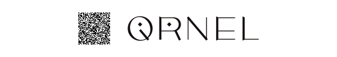
</picture>
</a>
 
A Rust operating system in one QR code. 
Bootloader, kernel, shell and two games fill exactly 2,953 bytes, 
the most a Version 40 code can hold at error-correction level L (7%). 
Rust · <a href="https://github.com/TKY-27/QRnel">Repository</a> · <a href="https://tky-27.github.io/QRnel/">Demo</a>

 
<picture>
<source media="(prefers-color-scheme: dark)" srcset="assets/type/stack-dark.svg">
</picture>

<picture>
<source media="(prefers-color-scheme: dark)" srcset="assets/icons/python-dark.svg">
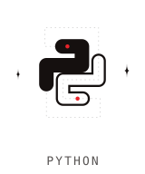
</picture>
<picture>
<source media="(prefers-color-scheme: dark)" srcset="assets/icons/rust-dark.svg">
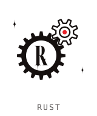
</picture>
<picture>
<source media="(prefers-color-scheme: dark)" srcset="assets/icons/c-dark.svg">
</picture>

 
<picture>
<source media="(prefers-color-scheme: dark)" srcset="assets/type/activity-dark.svg">
</picture>
<picture>
<source media="(prefers-color-scheme: dark)" srcset="assets/activity-dark.svg">
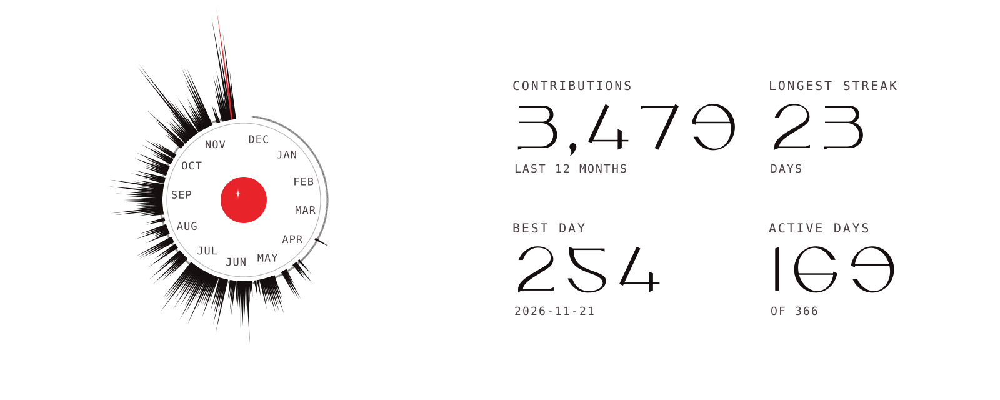
</picture>
<picture>
<source media="(prefers-color-scheme: dark)" srcset="assets/habits-dark.svg">
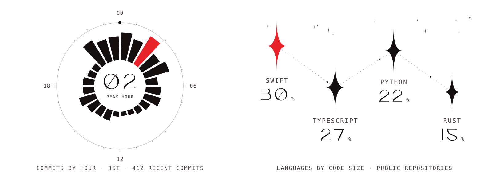
</picture>
 
<picture>
<source media="(prefers-color-scheme: dark)" srcset="assets/type/find-me-dark.svg">
</picture>

<a href="https://x.com/ANAg2bGOD">
<picture>
<source media="(prefers-color-scheme: dark)" srcset="assets/icons/x-dark.svg">
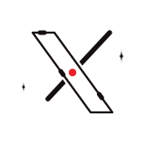
</picture>
</a>
&nbsp;&nbsp;&nbsp;

 
<a href="https://x.com/ANAg2bGOD">@ANAg2bGOD</a>

 

This banner weighs <!--hero-bytes-->169,742<!--/hero-bytes--> bytes. That is <!--hero-qrs-->58<!--/hero-qrs--> QR codes' worth. QRnel boots from one. 
Every mark above is drawn in SVG by script. Type: Spikes, Celestial Modern, Metrica.

